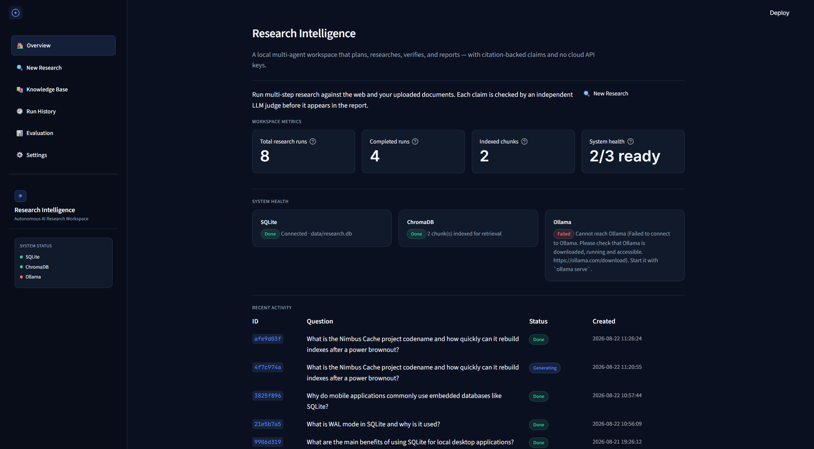
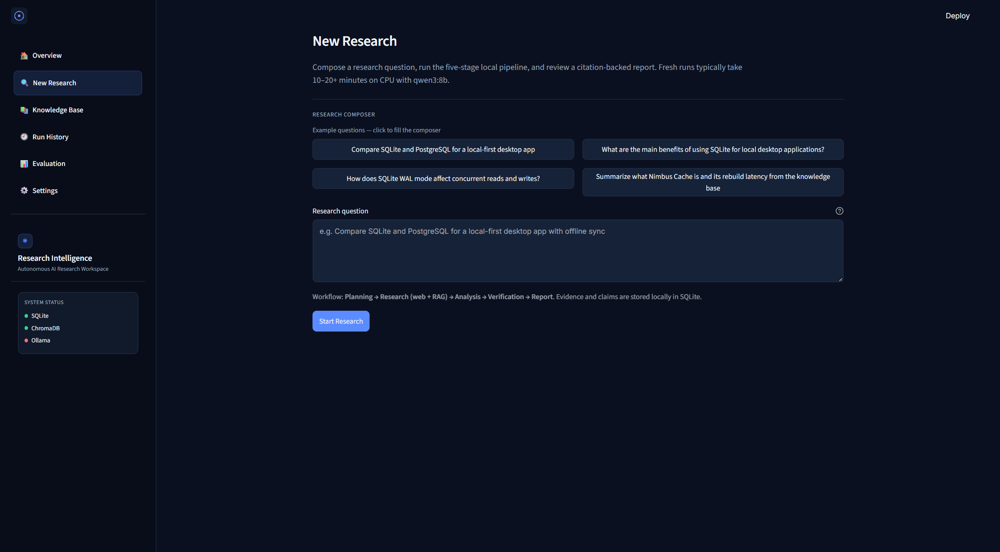
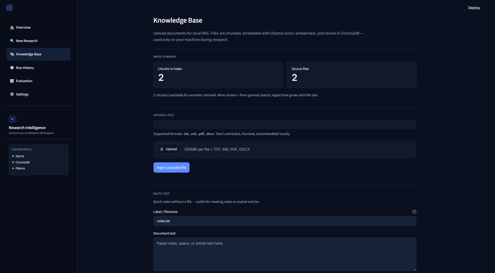
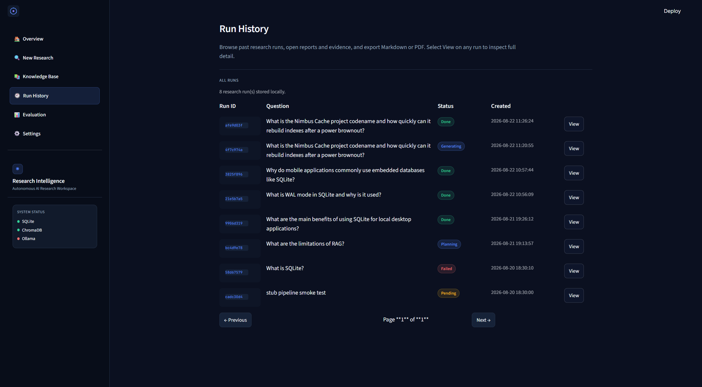
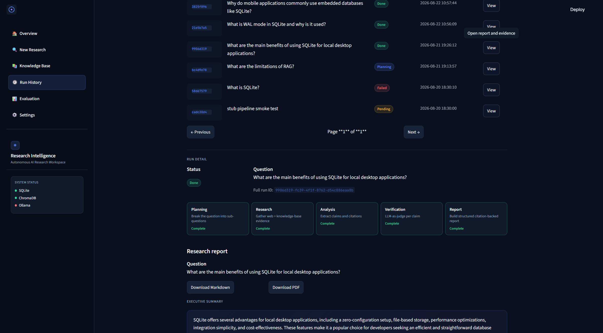
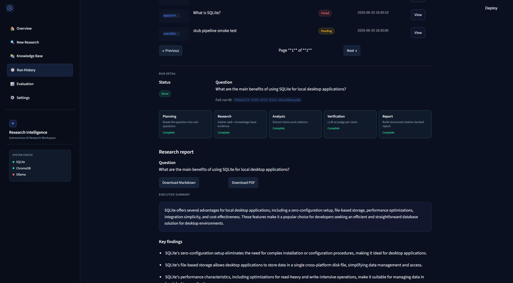
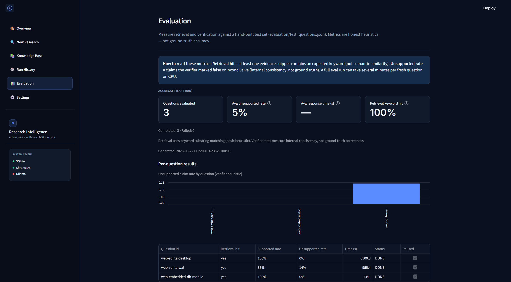
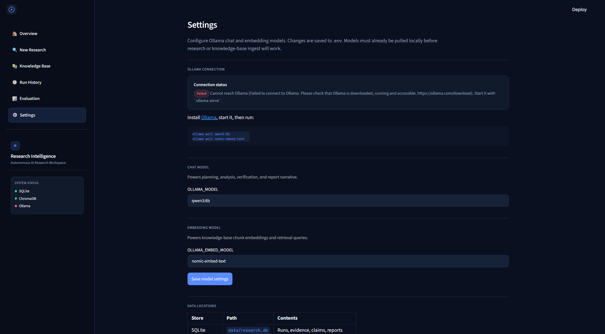

# Autonomous AI Research & Intelligence Platform

A **local, multi-agent research workspace** that turns a natural-language question into a citation-backed report. The system plans sub-questions, searches the web and your uploaded documents, extracts claims, verifies each claim with an independent LLM-as-judge, and exports Markdown or PDF — all in one Streamlit process on your machine.

No cloud API keys, Docker, or FastAPI required. Chat and embeddings run through **Ollama** (`qwen3:8b` + `nomic-embed-text`).



## Premium dark UI

The interface is a **premium dark research workspace** (deep navy `#0B1020`, electric blue `#5B8CFF`, restrained violet accents):

- Compact sidebar with product branding and live system status
- Overview dashboard with real workspace metrics and recent activity
- New Research composer with example questions and a five-stage pipeline view
- Polished report reading experience with verification badges and exports
- Knowledge Base, Run History, Evaluation, and Settings styled consistently

| Overview | New Research |
| --- | --- |
|  |  |

| Knowledge Base | Run History |
| --- | --- |
|  |  |

| Pipeline stages | Research report |
| --- | --- |
|  |  |

| Evaluation | Settings |
| --- | --- |
|  |  |

## Features

- **Planning** — LLM breaks a question into ordered sub-questions with tool hints
- **Web search** — DuckDuckGo (`ddgs`) retrieves live evidence with URLs
- **RAG / Knowledge Base** — upload `.txt`, `.md`, `.pdf`, or `.docx`; chunk, embed, retrieve via ChromaDB
- **Analysis** — extract claims, citations, contradictions, and gaps
- **Verification** — independent LLM-as-judge per claim (supported / unsupported / inconclusive)
- **Report generation** — structured sections + narrative; Markdown and PDF export
- **Evaluation** — hand-built test set with honest keyword retrieval + verifier consistency metrics
- **Premium dark UI** — Streamlit multipage app with shared design system (`ui/theme.py`)

## Architecture

```
                    ┌─────────────────────────────────────┐
                    │   Streamlit UI (Research Intelligence)│
                    │ Overview · Research · KB · History    │
                    │ Evaluation · Settings                 │
                    └─────────────────┬───────────────────┘
                                      │ direct Python calls
                                      ▼
                    ┌─────────────────────────────────────┐
                    │           pipeline.py               │
                    │  PLAN → RESEARCH → ANALYZE →        │
                    │  VERIFY → GENERATE REPORT           │
                    └──────┬──────────┬──────────┬────────┘
                           │          │          │
              ┌────────────▼──┐  ┌────▼────┐  ┌──▼──────────────┐
              │ agents/       │  │ tools/  │  │ core/           │
              │ planner       │  │ ddgs    │  │ db (SQLite)     │
              │ research      │  │ web     │  │ llm (Ollama)    │
              │ analyzer      │  │ search  │  │ vector_store    │
              │ verifier      │  └─────────┘  │ (ChromaDB)      │
              │ report_gen    │               └─────────────────┘
              └───────────────┘
                           │
              Ollama: qwen3:8b (chat) + nomic-embed-text (embeddings)
              Storage: data/research.db + data/chroma/
```

## Tech stack

| Layer | Choice | Notes |
| --- | --- | --- |
| UI | Streamlit + dark theme | `st.navigation`, shared CSS in `ui/theme.py` |
| Orchestration | `pipeline.py` | Sync, in-process |
| LLM | Ollama `qwen3:8b` | Local chat + JSON schema |
| Embeddings | Ollama `nomic-embed-text` | Explicit embed → Chroma |
| Vector store | ChromaDB (embedded) | `data/chroma/` |
| Database | SQLite + SQLAlchemy (sync) | `data/research.db` |
| Web search | `ddgs` | Free DuckDuckGo wrapper |
| PDF export | `fpdf2` | Pure Python |
| PDF / DOCX ingest | `pypdf` / `python-docx` | Knowledge Base uploads |

## Setup

**1. Install [Ollama](https://ollama.com)** and pull models:

```bash
ollama pull qwen3:8b
ollama pull nomic-embed-text
```

**2. Clone and install:**

```bash
git clone https://github.com/karthik2104-cr/Autonomous-AI-research-platform-with-multi-agent-architecture.git
cd Autonomous-AI-research-platform-with-multi-agent-architecture

python -m venv venv
# Windows:
venv\Scripts\activate
# macOS/Linux:
# source venv/bin/activate

pip install -r requirements.txt
```

**3. Configure environment:**

```bash
copy .env.example .env
# Unix: cp .env.example .env
```

**4. Launch:**

```bash
streamlit run app.py
```

Open [http://localhost:8501](http://localhost:8501). The **Overview** page shows workspace metrics and SQLite / ChromaDB / Ollama health.

All dependencies are pip-only — no wkhtmltopdf, Docker, or extra system services beyond Ollama.

## How to use

| Page | What it does |
| --- | --- |
| **Overview** | Dashboard: run counts, indexed chunks, system health, recent activity |
| **New Research** | Compose a question, start the five-stage pipeline, view report |
| **Knowledge Base** | Upload `.txt` / `.md` / `.pdf` / `.docx` or paste text; test retrieval |
| **Run History** | Browse runs, open reports, download Markdown/PDF, inspect evidence |
| **Evaluation** | Run the hand-built test set; view heuristic quality metrics |
| **Settings** | Set Ollama chat/embed model names (saved to `.env`) |

Typical flow:

1. *(Optional)* Add documents on **Knowledge Base**
2. Ask a question on **New Research** (expect **10–20+ minutes** on CPU for a fresh run)
3. Open the result in **Run History** and export Markdown or PDF

## Tests

```bash
python -m tests.smoke_test          # non-destructive UI + export checks
python -m tests.test_pdf_export     # PDF from demo run
python -m tests.test_kb_docx        # DOCX ingest + retrieval
python -m evaluation.run_eval --limit 3
```

## Configuration & troubleshooting

| Issue | Fix |
| --- | --- |
| Ollama unreachable | Start Ollama (`ollama serve`) and confirm models are pulled |
| Empty Knowledge Base retrieval | Ingest a file first; embed model must match `OLLAMA_EMBED_MODEL` |
| Slow research runs | Expected on CPU with `qwen3:8b`; reuse DONE runs in Evaluation |
| PDF download errors | Ensure `fpdf2` is installed; export uses stored `content_json` only |

Data locations (local, gitignored contents):

| Store | Path |
| --- | --- |
| SQLite | `data/research.db` |
| ChromaDB | `data/chroma/` |
| Env | `.env` (from `.env.example`) |

## Known limitations

- Evaluation retrieval = **keyword substring** match (not semantic similarity)
- Verifier rates = **internal consistency**, not ground-truth accuracy
- CPU inference is slow for full fresh pipelines
- Single-user Streamlit app (no auth / job queue)
- Schema via `create_all` + lightweight `ALTER` (no Alembic yet)

See `DECISIONS.md` for architecture trade-offs and upgrade paths.

## Future improvements

- Embedding-based evaluation and/or LLM grader scoring
- Larger hand-labeled eval set
- Multi-turn query rewriting
- Postgres + job queue for multi-user
- Optional FastAPI boundary for non-Streamlit clients

## Project structure

```
app.py                      Streamlit entry + Overview dashboard
pages/                      New Research, KB, History, Settings, Evaluation
pipeline.py                 run_research() orchestration
ui/
  theme.py                  Dark design system + shared helpers
  components.py             Report / plan rendering
core/                       DB, models, LLM, Chroma, ingest, health
agents/                     Planner, research, analyzer, verifier, report gen
tools/web_search.py         DuckDuckGo wrapper
utils/pdf_export.py         Report → PDF bytes
evaluation/                 Test questions, metrics, run_eval.py
tests/                      Smoke and e2e scripts
testdata/                   Sample KB documents
screenshots/                README UI captures (premium dark theme)
assets/logo.svg             Sidebar product mark
.streamlit/config.toml      Streamlit dark theme
data/                       Runtime SQLite + Chroma (gitignored contents)
DECISIONS.md
.env.example
requirements.txt
```

## License

Use freely for portfolio and learning. Attribution appreciated.
